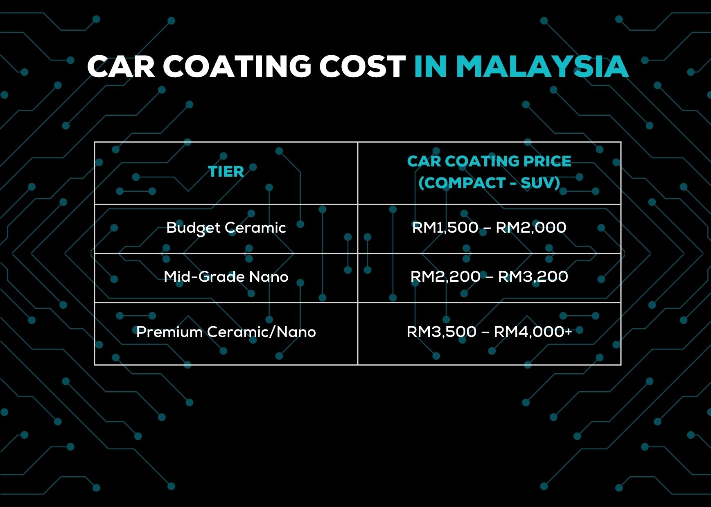
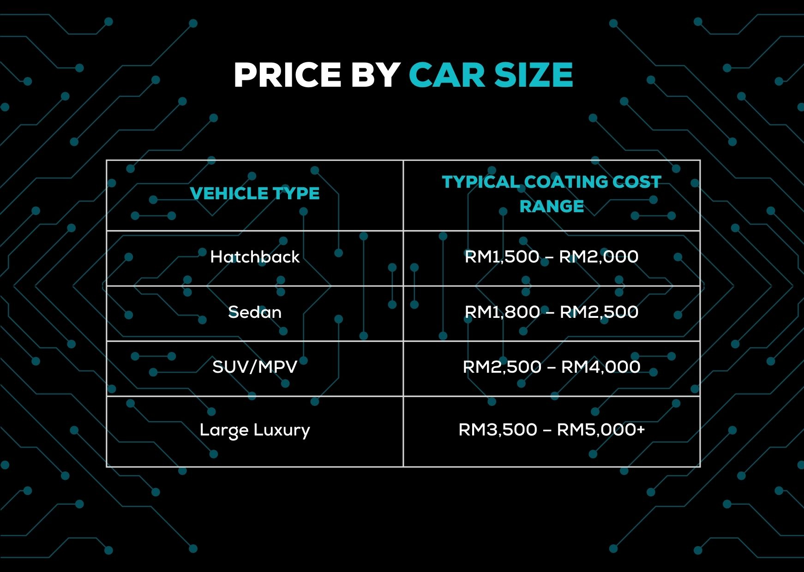
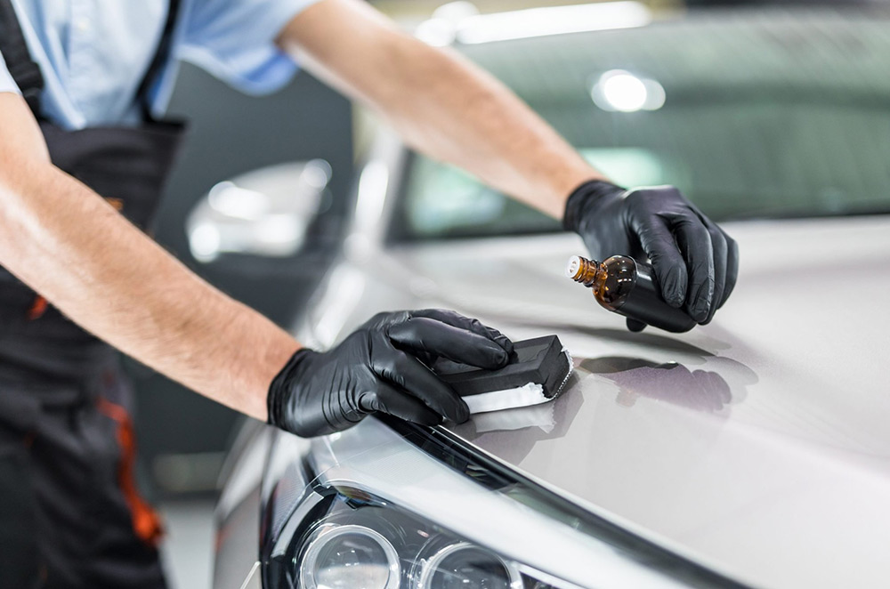
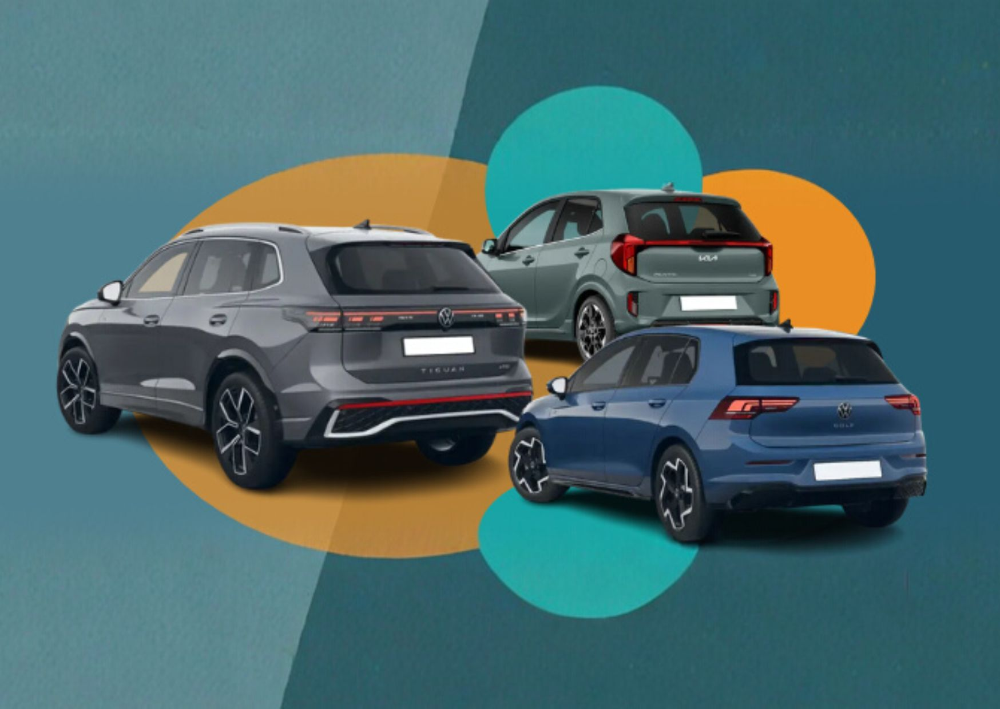
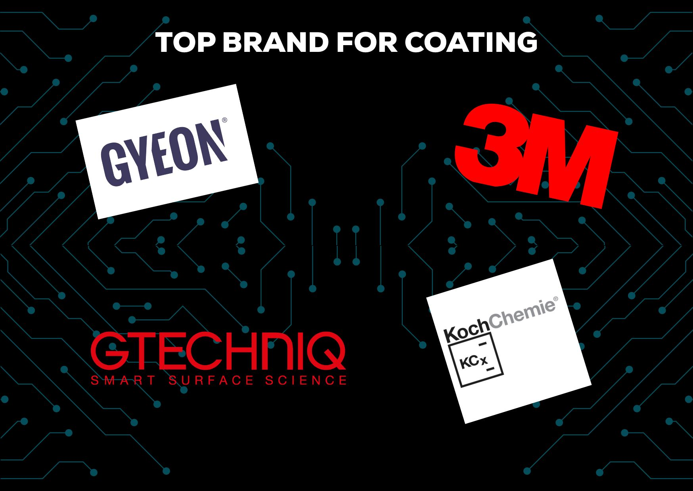
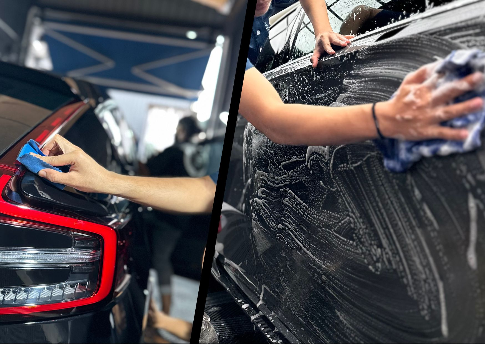
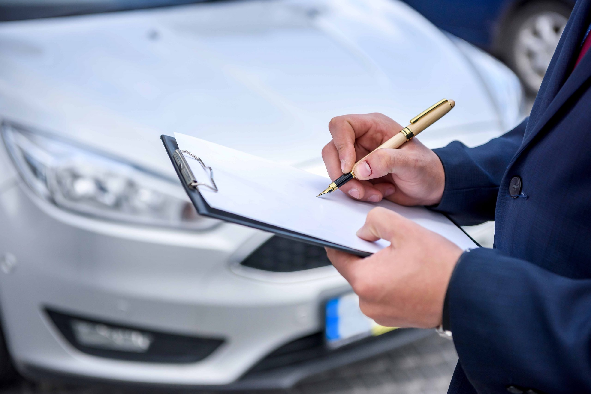
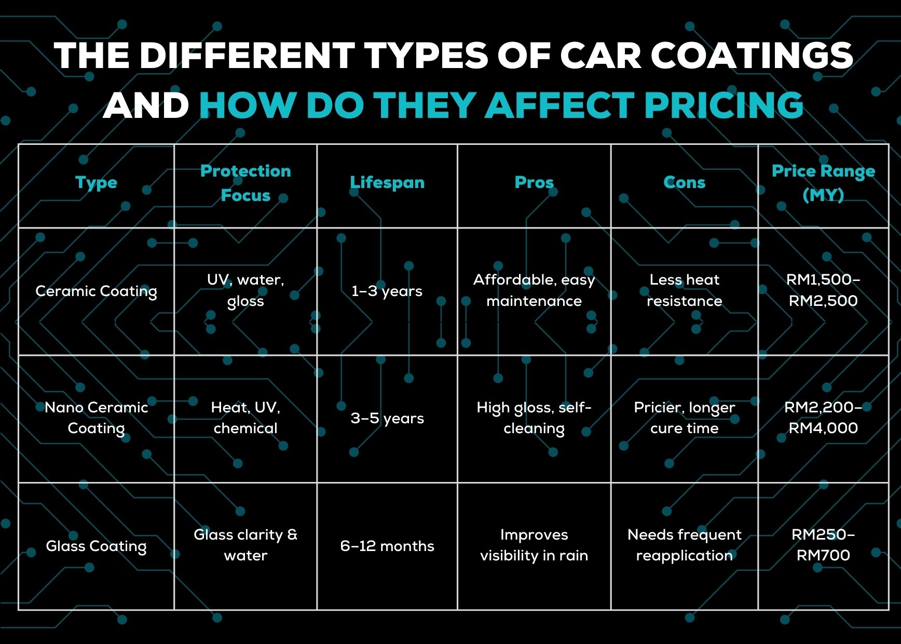
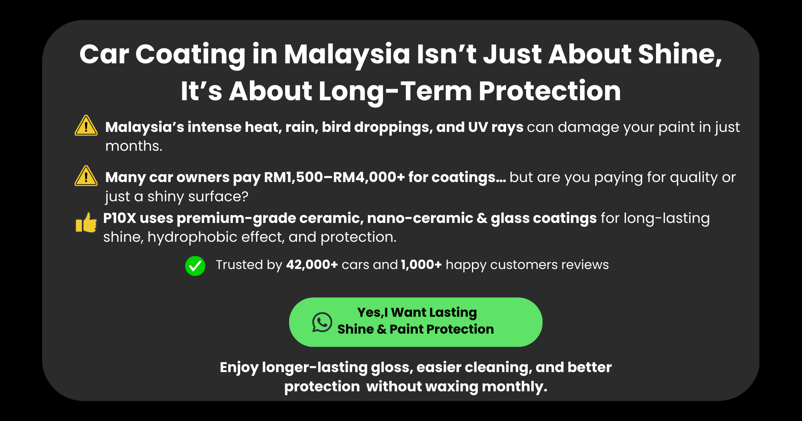

If you’re wondering about <strong>car coating price</strong> in Malaysia, you’re not alone. With the rising popularity of <a href="/insights/ceramic-coating/"><strong><u>nano-ceramic coating</u></strong></a><a href="/insights/ceramic-coating/"><u> </u></a>and other high-performance solutions, many car owners are now looking beyond traditional waxes for better, longer-lasting paint protection. Whether you’re <a href="/insights/tesla-ppf/"><u>protecting a brand-new Tesla</u></a> or restoring the gloss on your daily ride, understanding car coating costs in 2025 helps you make the right decision — balancing protection, shine, resale value, and peace of mind. This <strong>best car coating Malaysia</strong> guide breaks down pricing tiers, coating types, and real-world value to help you choose with confidence.

<h2 class="content-heading" id="viewer-ntfmx22024">Table of Content :</h2>

<ul class="content-list"> <li> 
<a href="#viewer-kehx520073"><u>What car coating is and why is it important?</u></a>
 </li> <li> 
<a href="#viewer-2xo2r20121"><u>How Much Does Car Coating Cost in Malaysia?</u></a>
 </li> <li> 
<a href="#viewer-c5d5420215"><u>What are the factors that affect ceramic coating cost</u></a>
 </li> <li> 
<a href="#viewer-dzhcm14385"><u>What Are the Different Types of Car Coatings and How Do They Affect Pricing?</u></a>
 </li> <li> 
<a href="#viewer-2mzkb15237"><u>How Car Coating Warranties Protect Your Investment</u></a>
 </li> <li> 
<a href="#viewer-j1ckp16072"><u>P10X: Over 1,000 5-Star Reviews &amp; 32 Certified Installers</u></a>
 </li> </ul>

<h2 class="content-heading" id="viewer-kehx520073">What Is Car Coating and Why Is It Important?</h2>

<strong>Car coating</strong> is a liquid polymer applied to your vehicle’s exterior that chemically bonds to the paint, forming a durable, protective layer.

Common types include:

<ul class="content-list"> <li> 
<strong>Ceramic coating</strong> – offers UV protection, gloss, and hydrophobicity.
 </li> <li> 
<strong>Nano-ceramic coating</strong> – more refined with higher heat resistance and tighter molecular structure.
 </li> <li> 
<strong>Car glass coating</strong> – applied to windscreens and windows to repel water and improve visibility.
 </li> </ul>

These coatings act like a sacrificial barrier that resists:

<ul class="content-list"> <li> 
Bird droppings
 </li> <li> 
UV rays
 </li> <li> 
Water spots
 </li> <li> 
Chemical stains
 </li> <li> 
Swirl marks
 </li> </ul>

Unlike wax (which wears off in weeks) or sealants (which last a few months), coatings last <strong>1–5 years</strong> depending on product grade and maintenance. In Malaysia’s harsh climate — hot sun, acid rain, dusty roads — coatings are a smart, long-term investment. At <strong>P10X</strong>, we use only premium coating brands with certified technicians and documented processes for preparation and application.

<h2 class="content-heading" id="viewer-2xo2r20121"> How Much Does Car Coating Cost in Malaysia?</h2>

Here’s a general breakdown for <strong>car coating Malaysia price</strong> in 2025:

<figure class="content-image size-full"></figure>

<h3 class="content-heading" id="viewer-ixss420156">Price by Car Size</h3>

<figure class="content-image size-full"></figure>

<h3 class="content-heading" id="viewer-vcxd320194">P10X Headline Prices</h3>

<ul class="content-list"> <li> 
<strong>Windscreen coating price</strong>: from RM250
 </li> <li> 
<strong>Interior coating price</strong>: from RM500
 </li> <li> 
<strong>Full car ceramic coating cost</strong>: RM1,500 – RM4,000 (depending on coating grade, car size, and prep level)
 </li> </ul>

Pro tip: Proper surface prep and controlled curing can make your coating last longer — saving you more in the long run. Looking for “<strong>car coating near me</strong>”? Make sure to compare coating brands, preparation process, and aftercare plans.

<h2 class="content-heading" id="viewer-c5d5420215">What Are the Factors That Affect Car Coating Price?</h2>

<h3 class="content-heading" id="viewer-6rs3m20217">Quality of Coating</h3>

<ul class="content-list"> <li> 
<strong>Entry level</strong>: 1 layer, basic protection, shorter lifespan (12–18 months)
 </li> <li> 
<strong>Mid grade</strong>: 2 layers, better gloss and hydrophobicity
 </li> <li> 
<strong>Pro level</strong>: 3–5 layers, higher hardness rating, longer durability (up to 5 years)
 </li> </ul>

Tip: The <strong>price for ceramic coating</strong> goes up with thickness, brand reputation, and included top coats.

<figure class="content-image size-full"></figure>

<h3 class="content-heading" id="viewer-9q5jn20236">Car Size and Paint Condition</h3>

<ul class="content-list"> <li> 
Larger vehicles = more coating needed = higher cost
 </li> <li> 
Poor paint condition = more polishing and correction = more labour time
 </li> </ul>

A scratched or dull surface may require 2–8 hours of paint correction before coating, affecting <strong>nano ceramic coating price</strong> significantly.

<figure class="content-image size-full"></figure>

<h3 class="content-heading" id="viewer-s3pt120249">Brand and Specification</h3>

Well-known brands (Gyeon, Gtechniq, Koch chemie, 3M, etc.) often have:

<ul class="content-list"> <li> 
Tested chemical data
 </li> <li> 
Local warranty support
 </li> <li> 
UV and gloss test ratings
 </li> </ul>

<figure class="content-image size-full"></figure>

At P10X, we only use reputable brands with transparent specifications and warranty support.

<h3 class="content-heading" id="viewer-2h6gy20265">Installation and Preparation</h3>

Cheap coatings skip prep.

At P10X, our prep includes:

<ul class="content-list"> <li> 
2-bucket wash method
 </li> <li> 
Iron and tar decontamination
 </li> <li> 
Clay bar
 </li> <li> 
Paint correction
 </li> <li> 
Panel wipe
 </li> </ul>

<figure class="content-image size-full"></figure>

This ensures the coating bonds perfectly and protects your car longer.

<h3 class="content-heading" id="viewer-57esa20289">Coverage Area and Add-Ons</h3>

Want more than just paint protection?

<ul class="content-list"> <li> 
<strong>Windscreen coating price</strong>: RM250+
 </li> <li> 
<strong>Car glass coating price</strong> (full): RM400–RM700
 </li> <li> 
<strong>Interior coating</strong>: RM500+
 </li> <li> 
<strong>Wheel &amp; caliper coating</strong>: RM300+
 </li> <li> 
<strong>Headlight/trim/plastic coating</strong>: varies
 </li> </ul>

More coverage = higher price, but also better total protection.

<h3 class="content-heading" id="viewer-ocz6520316">Warranty and Aftercare</h3>

Most quality coatings come with <strong>2–5 year warranties</strong>. These often include:

<ul class="content-list"> <li> 
Free inspection every 6–12 months
 </li> <li> 
Maintenance plans
 </li> <li> 
Recoating or repair of failed areas
 </li> </ul>

At P10X, we help clients maintain coating quality through scheduled inspections and proper aftercare support — extending value beyond the initial cost.

<figure class="content-image size-full"></figure>

<h2 class="content-heading" id="viewer-dzhcm14385">What Are the Different Types of Car Coatings and How Do They Affect Pricing?</h2>

<figure class="content-image size-full"></figure>

<h3 class="content-heading" id="viewer-s1ibv20413">Ceramic Coating Price</h3>

Best for those wanting better shine and easy cleaning without breaking the bank.

<h3 class="content-heading" id="viewer-qg1p720417">Nano Ceramic Coating Price</h3>

Great for serious enthusiasts — enhanced gloss, durability, and chemical resistance.

<h3 class="content-heading" id="viewer-bbrqh20421">Glass Coating Price</h3>

Affordable way to improve visibility and water-beading on windows.

<h2 class="content-heading" id="viewer-2mzkb15237">How Car Coating Warranties Protect Your Investment</h2>

There are two types:

<ul class="content-list"> <li> 
<strong>Installer-backed</strong>: given by your coating studio
 </li> <li> 
<strong>Brand-backed</strong>: warranty by the coating manufacturer
 </li> </ul>

Look for:

<ul class="content-list"> <li> 
Claim process clarity
 </li> <li> 
Maintenance checklist
 </li> <li> 
Free inspection intervals
 </li> </ul>

At P10X, we provide detailed care instructions and warranty coverage per package — no guesswork, no vague terms.

<h2 class="content-heading" id="viewer-j1ckp16072">P10X: Over 1,000 5-Star Reviews &amp; 32 Certified Installers</h2>

<figure class="content-image size-full"></figure>

 Not all coating shops are created equal.

✅ Why P10X?

<ul class="content-list"> <li> 
Over <strong>42,388 cars</strong> coated
 </li> <li> 
<strong>1,168</strong> verified 5-star reviews
 </li> <li> 
<strong>32 trained &amp; certified installers</strong>
 </li> <li> 
Controlled lighting and curing environment
 </li> <li> 
Strict surface prep checklist
 </li> <li> 
Premium coating brands only
 </li> </ul>

📞 Book a free consultation and find out how we can protect your ride for years.

<h2 class="content-heading" id="viewer-xfrxu20482">Conclusion</h2>

Understanding <strong>car coating price</strong> in Malaysia helps you make the smartest decision for your car.

Remember:

<ul class="content-list"> <li> 
Coating isn’t just about looks — it’s protection and long-term value.
 </li> <li> 
Choose the right type (ceramic, nano, or glass) for your budget and lifestyle.
 </li> <li> 
Prep and warranty matter as much as the product itself.
 </li> </ul>

🛡️ <strong>P10X Prices Recap</strong>:

<ul class="content-list"> <li> 
<strong>Windscreen Coating</strong> – from RM250
 </li> <li> 
<strong>Interior Coating</strong> – from RM500
 </li> <li> 
<strong>Full Car Coating</strong> – from RM1,500 to RM4,000+
 </li> </ul>

<h2 class="content-heading" id="viewer-9qwbz20519">FAQ</h2>

<strong>What is the cost of coating for cars?</strong>

Prices vary depending on the package. Expect RM1,500–RM4,000+ for full car ceramic coating at authorized studios.

<strong>How long can a car coating last?</strong>

1–5 years depending on the product type and aftercare.

<strong>Which car coating is best?</strong>

Nano-ceramic offers the best durability and hydrophobicity, but ceramic is great for affordability.

<strong>Which is better, 9H or 10H ceramic coating?</strong>

10H is harder and more scratch-resistant, but overall formulation matters more than just hardness rating.

<strong>Can I wax over ceramic coating?</strong>

Yes, but it’s not necessary. Most ceramic coatings have high gloss and don’t need wax.

<h2 class="content-heading" id="viewer-4khu625323">About the Author </h2>

<figure class="content-image size-full"></figure>

He is passionate about revolutionizing the car protection services industry by bringing innovation and transparency to a traditionally opaque and often misunderstood field. His mission is to educate end users on the true benefits and importance of car protection, aiming to replace outdated practices with honest, customer-focused solutions.

With a fresh approach to car tinting, paint protection film (PPF), and detailing services, he is committed to delivering a superior customer experience that sets a new standard in the market. He welcomes discussions about the future of the automotive industry and is eager to connect with like-minded professionals who share his vision for innovation, integrity, and excellence.

