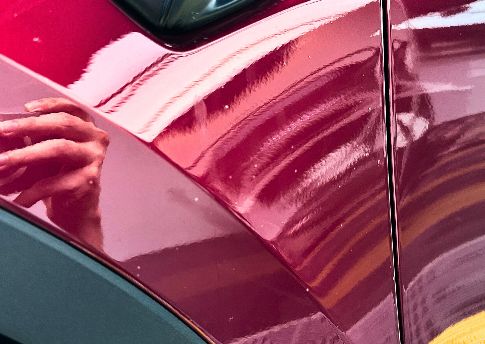
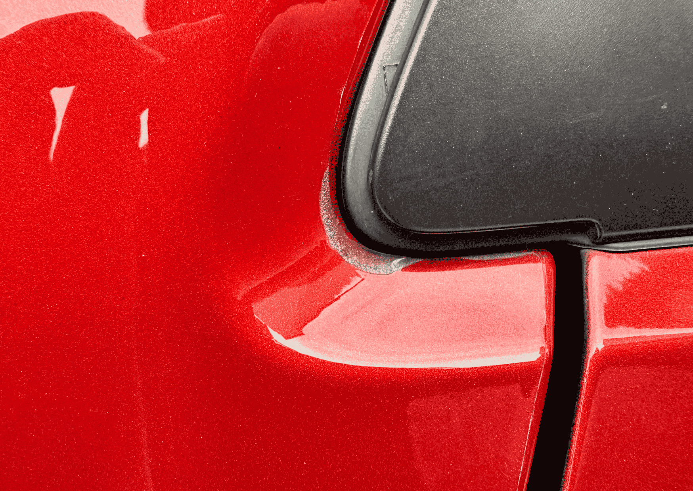
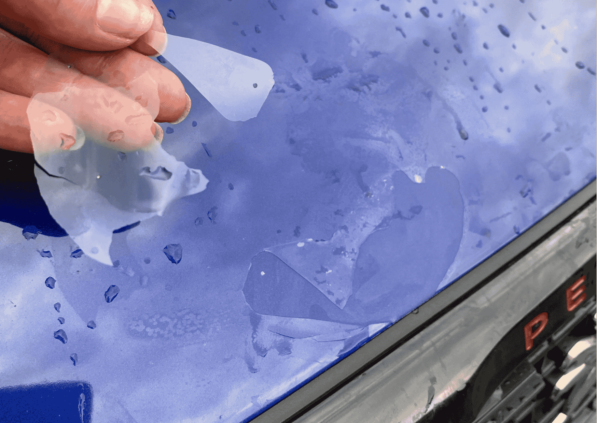
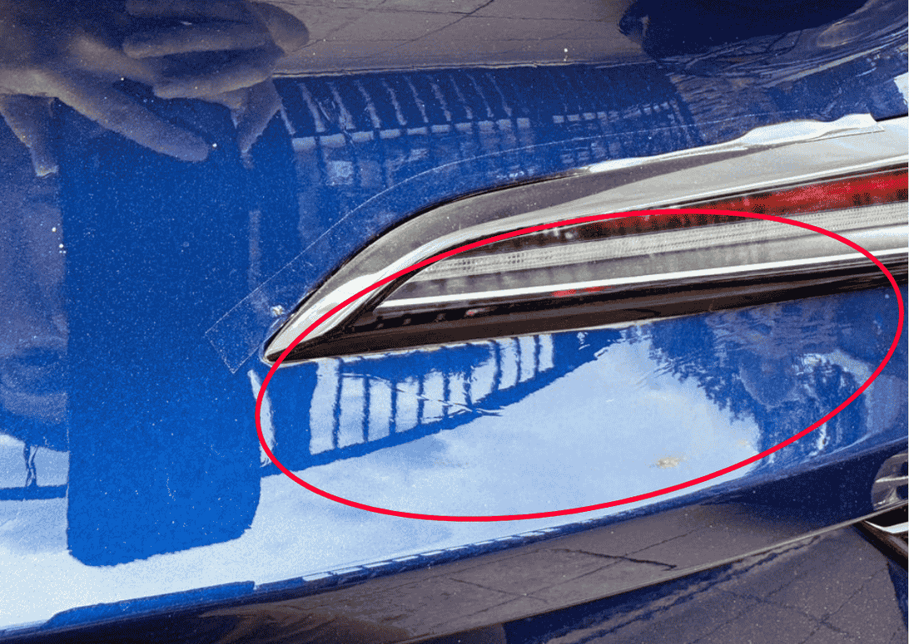
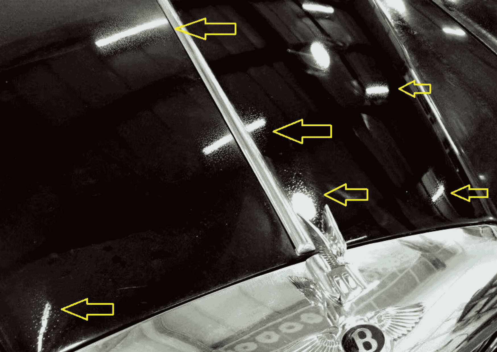
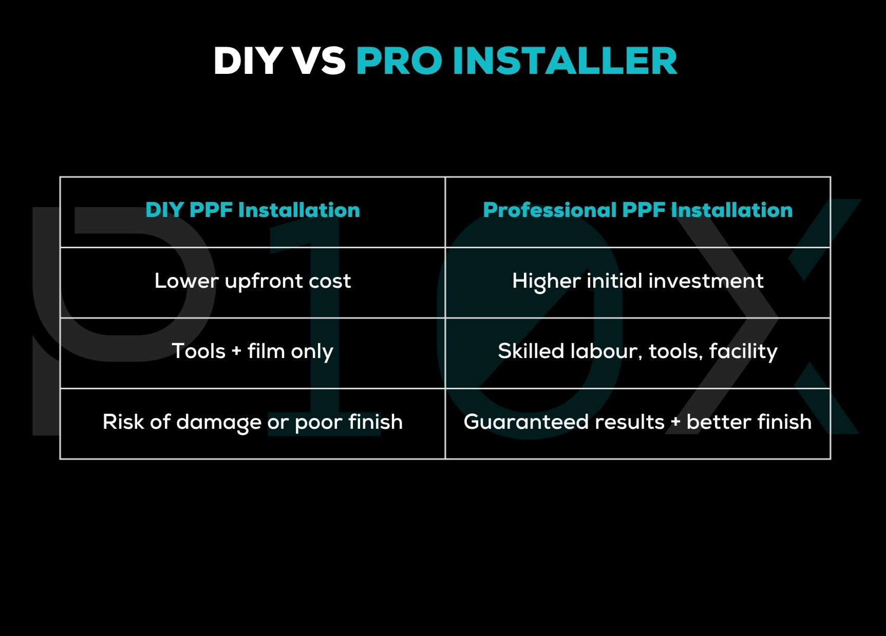
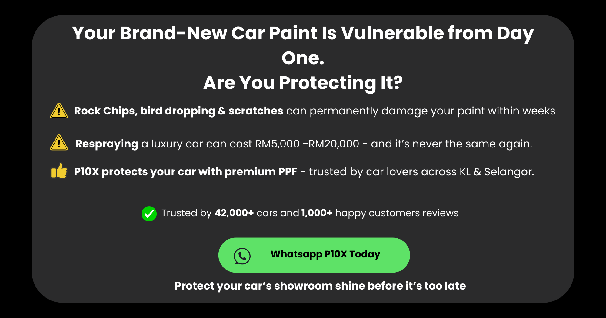

If you’ve ever winced at a stone chip or dreaded the sight of swirl marks on your car, you’re not alone. Many Malaysian car owners today are turning to Paint Protection Film (PPF) — also known as car PPF, car protection film, or PPF wrap — as their go-to solution for long-term paint protection. But how exactly is PPF installed? Is it something you can do yourself, or should you trust the pros? To understand the full process, check out our guide: <strong>‘How to Install PPF Film: A Step-by-Step Guide with Pro Insights ‘ </strong>for a detailed breakdown and expert tips.

Table of Content

<ul class="content-list"> <li> 
<a href="#viewer-meftm5496"><u>Pre-PPF Installation: Surface Preparation.</u></a>
 </li> <li> 
<a href="#viewer-1v4g35547"><u>PPF Installation Process: A Step-by-step Guide</u></a>
 </li> <li> 
<a href="#viewer-u3af25603"><u>Post-PPF Installation: Curing Period and First 2 Weeks of Aftercare</u></a>
 </li> <li> 
<a href="#viewer-v08vn5632"><u>Tools Needed for PPF Installation</u></a>
 </li> <li> 
<a href="#viewer-el99n5659"><u>Tips for Applying PPF</u></a>
 </li> <li> 
<a href="#viewer-zfknc5674"><u>Common PPF Installation Mistakes and How to Fix Them</u></a>
 </li> </ul>

In this guide, we’ll walk you through how to install PPF film — step-by-step — while sharing professional insights along the way. Whether you’re just curious or seriously considering a DIY attempt, this article will help you make an informed decision. If you’re new to the concept, check out our full guide on <a href="https://www.p10x.my/post/car-ppf-malaysia-guide"><u>Car PPF in Malaysia</u></a> to understand the pros, cons, costs, and types.

<h2 class="content-heading" id="viewer-meftm5496">Pre-PPF Installation: Surface Preparation</h2>

<h3 class="content-heading" id="viewer-bi7jw5498">1. Deep Cleaning the Car Exterior</h3>

Before you even think about installing PPF, your car needs to be squeaky clean — and we mean deep-cleaned.

Here’s how professionals prep the surface:

<ul class="content-list"> <li> 
<strong>Foam wash &amp; rinse:</strong> Removes dust, grime, and surface-level dirt.
 </li> <li> 
<strong>Iron &amp; tar remover:</strong> Eliminates stubborn contaminants stuck to your paint.
 </li> <li> 
<strong>Clay bar treatment:</strong> Lifts out fine particles that can’t be washed away.
 </li> </ul>

This ensures the film sticks properly without trapping any debris.

<h3 class="content-heading" id="viewer-a6bdt5519">2. Paint Inspection and Correction</h3>

Installing PPF over flawed paint only locks in those imperfections. That’s why inspecting and correcting the paint is so important, especially for used vehicles.

Paint correction includes:

<ul class="content-list"> <li> 
Checking for <strong>swirl marks</strong>, <strong>scratches</strong>, <strong>water spots</strong>, or <strong>oxidation</strong>
 </li> <li> 
Correcting paint flaws through <strong>machine polishing or compounding</strong>
 </li> <li> 
Ensuring the surface is smooth, clean, and gloss-ready
  </li> </ul>

<h3 class="content-heading" id="viewer-5ry1p5543">3. Optional: Polishing for Maximum Shine</h3>

Want that glass-like finish before your PPF goes on? A final polish enhances your paint’s depth and gloss, making it truly pop under the film, especially if you’re going with clear or colour PPF.

<h2 class="content-heading" id="viewer-1v4g35547">PPF Installation Process: A Step-by-step Guide</h2>

<h3 class="content-heading" id="viewer-by97n5549">1. PPF Film Cutting</h3>

There are two main cutting methods:

<ul class="content-list"> <li> 
<strong>Pre-cut PPF:</strong> Digitally designed to fit specific car models. Clean, accurate, and blade-free.
 </li> <li> 
<strong>Hand-cut PPF:</strong> Done manually by skilled installers to fit unique or modified areas.
 </li> </ul>

Choosing between pre-cut and hand-cut PPF depends on your car model and preference. To explore your options, take a look at the different <a href="/insights/pre-cut-vs-hand-cut-ppf-guide/"><u>types of PPF film</u></a> available in the market, including TPU, gloss, matte, and colour PPF.

<h3 class="content-heading" id="viewer-ixb3h5564">2. Optional: Panel Removal for Seamless Application</h3>

Panel removal (like taking off door handles or lights) allows PPF to wrap around edges seamlessly. While not always necessary, it’s a standard in professional shops like <strong>P10X</strong>, ensuring cleaner results and better longevity.

<h3 class="content-heading" id="viewer-ozkk05570">3. Applying the PPF Film</h3>

Now the real action begins.

Here’s how it’s done:

<ul class="content-list"> <li> 
Spray a <strong>slip solution</strong> (water + soap) on the panel and adhesive side of the film
 </li> <li> 
Lay the film gently over the surface
 </li> <li> 
Use a <strong>squeegee and tack solution</strong> to press it into place, starting from the centre
 </li> <li> 
Apply heat with a <strong>hot air gun</strong> to stretch and conform the film
 </li> <li> 
Smooth out all <strong>air bubbles, wrinkles, and fingers</strong>
 </li> </ul>

<h2 class="content-heading" id="viewer-u3af25603">Post-PPF Installation: Curing Period and First 2 Weeks of Aftercare</h2>

<h3 class="content-heading" id="viewer-d7xxn5605">What is the Curing Period?</h3>

Curing is the 14-day period after installation during which the adhesive sets and the moisture under the film evaporates.

<h3 class="content-heading" id="viewer-qs8dr5609">What to Avoid during Curing?</h3>

<ul class="content-list"> <li> 
Don’t wash or wax the car
 </li> <li> 
Don’t poke or press air bubbles
 </li> <li> 
Avoid parking under tree sap or bird droppings
  </li> </ul>

<h3 class="content-heading" id="viewer-p205p5621">What to Do during Curing?</h3>

<ul class="content-list"> <li> 
Park the car under <strong>mild sunlight</strong> to help dry
 </li> <li> 
Gently check for bubbles — most will disappear as the film cures
 </li> </ul>

<h2 class="content-heading" id="viewer-v08vn5632">Tools Needed for PPF Installation</h2>

Here’s a breakdown of essential tools for installing PPF:

<h3 class="content-heading" id="viewer-103h05636">🔥 Hot Air Machine</h3>

Used to stretch and activate adhesive, helps conform to curves.

<h3 class="content-heading" id="viewer-x649m5640">✂️ Digital Cutter</h3>

Provides precise cuts tailored to your car — ideal for pre-cut PPF.

<h3 class="content-heading" id="viewer-1dwvu5644">📦 Pre-cut PPF</h3>

Great for DIY installers who want a safer, easier approach.

<h3 class="content-heading" id="viewer-jwj6y5648">🪒 Blade</h3>

Used by pros for manual cutting. Not recommended for beginners due to paint risk.

<h3 class="content-heading" id="viewer-uij4v5652">💧 Water, Soap &amp; Alcohol</h3>

Used to create slip and tack solutions. You’ll also need spray bottles, measuring cups, and clean containers.

<blockquote class="content-quote is-layout-flow content-quote-is-layout-flow">💡 Remember: Installing PPF isn’t just about tools — it’s about technique. For best results, professional installation is still the smartest choice.</blockquote>

<h2 class="content-heading" id="viewer-el99n5659">Tips for Applying PPF</h2>

<ul class="content-list"> <li> 
<strong>Work in a clean, controlled space:</strong> Dust and wind can ruin your application.
 </li> <li> 
<strong>Use plenty of slip solution:</strong> It helps you reposition the film easily.
 </li> <li> 
<strong>Start small:</strong> Begin with flat surfaces like the hood before tackling curves.
  
The tools you’ll need depend on the level of protection you want and your budget. For a clearer picture, here’s a full breakdown of <a href="/insights/ppf-cost-malaysia/"><u>PPF cost in Malaysia</u></a>, whether you’re going DIY or going pro.
  </li> </ul>

<h2 class="content-heading" id="viewer-zfknc5674">Common PPF Installation Mistakes and How to Fix Them</h2>

<figure class="content-image size-full"></figure>

<h3 class="content-heading" id="viewer-wi0cr5678">Trapped Bubbles, Air Pockets, and Contamination</h3>

<strong>Causes:</strong> Dirt under the film, not squeegeeing air properly

<strong>Fix:</strong> Lift the film gently and reapply. Avoid using heat early.

<strong>Note:</strong> Some water pockets are normal and will disappear during curing.

<figure class="content-image size-full"></figure>

<h3 class="content-heading" id="viewer-zrfhn5688">Lifting or Peeling Edges</h3>

<strong>Causes:</strong> Bad technique, pressure washers, ageing film

<strong>Fix:</strong> Get it corrected early by a pro. Avoid spraying edges with high-pressure water.

<figure class="content-image size-full"></figure>

<h3 class="content-heading" id="viewer-o3rtd5695">Car Paint Damage from Poor Installation or Removal</h3>

<strong>Causes:</strong> Blade use on paint, improper removal

<strong>Fix:</strong> Use <strong>pre-cut PPF</strong> or a digital plotter. Only let <strong>trained pros</strong> handle removal.

✅ At <strong>P10X</strong>, our certified team ensures no paint damage — especially important for repainted surfaces.

<figure class="content-image size-full"></figure>

<h3 class="content-heading" id="viewer-6yqrb5710">Stretch Marks and Film Deformation</h3>

<strong>Causes:</strong> Overstretching during installation

<strong>Fix:</strong> Skilled hands are key. Avoid stretching beyond limits.

<figure class="content-image size-full"></figure>

<h3 class="content-heading" id="viewer-rv3ia5717">Visible Paint Imperfections Under the Film</h3>

<strong>Causes:</strong> Paint flaws not corrected before installation 

<strong>Fix:</strong> Always do paint correction or polish before applying PPF, especially for older cars.

✅ P10X includes this step in every installation, no matter whether a new or older car.

<h2 class="content-heading" id="viewer-o6t6x5726">Professional PPF Installation vs DIY: Which is Right for You?</h2>

<figure class="content-image size-full"></figure>

A professional install may cost more upfront, but it saves you headaches, rework, and possible damage costs in the long run. While DIY PPF can save some cost upfront, many car owners eventually realise that professional installation offers better results. Wondering if it’s worth it? This breakdown on <a href="/insights/is-ppf-worth-it/"><u>whether PPF is worth it</u></a> might help you decide.

<h2 class="content-heading" id="viewer-y0f8w5766">Worried About DIY PPF? Choose P10X Professional Installation in Malaysia</h2>

At <strong>P10X</strong>, our installers:

<ul class="content-list"> <li> 
Have over <strong>14+ years of experience</strong> with 250+ car models
 </li> <li> 
Are all <strong>trained and certified by </strong><a href="https://p10xacademy.edu.my"><strong><u>P10X Academy</u></strong></a><strong> (SLDN Certified)</strong>
 </li> <li> 
Use a <strong>digital cutter for a precise fit</strong>, and are skilled in <strong>manual techniques</strong> too
 </li> <li> 
Prioritise <strong>paint correction and surface prep</strong> before every install
 </li> </ul>

We use only <strong>high-grade TPU PPF films</strong>, and our responsive aftercare ensures peace of mind long after your appointment.

<figure class="content-image size-full"></figure>

<h2 class="content-heading" id="viewer-1ll645801">Conclusion</h2>

Installing car protection film takes more than just cutting and sticking. Whether you try to learn how to install PPF yourself or leave it to the pros, it all comes down to skill, patience, and preparation. PPF is one of the best ways to preserve your car’s paint, but it’s not your only option. Curious how it compares? See how it stacks up in our comparisons: <a href="https://www.p10x.my/post/ppf-vs-vinyl-wrap"><u>PPF vs vinyl wrap</u></a> and <a href="https://www.p10x.my/post/ppf-vs-ceramic-coating"><u>PPF vs ceramic coating.</u></a>

👉 Want a perfect finish without the guesswork? <strong>Let P10X take care of it.</strong><strong> </strong>Still deciding which brand to go for? Here’s a curated list of the <a href="/insights/best-ppf-film-malaysia/"><u>best PPF films in Malaysia</u></a> to help you make the right choice.

<h2 class="content-heading" id="viewer-phe8b5808"><strong>FAQ</strong></h2>

<strong>Can you install PPF yourself?</strong>

Yes, you can install a small section yourself if you have the right tools and a clean, controlled space — but it’s easy to make costly mistakes. For the best results, professional installation is highly recommended.

<strong>What liquid is used to install PPF?</strong>

A mix of water, baby shampoo or slip solution for positioning, and isopropyl alcohol for tack solution.

<strong>Can I pressure wash my car after PPF?</strong>

Wait at least 14 days. Avoid high pressure near film edges to prevent lifting.

<strong>Will the bubble in PPF go away?</strong>

Most small bubbles are moisture pockets and disappear within the curing period (up to 2 weeks).

<strong>Can I keep PPF on forever?</strong>

No, most high-quality TPU PPF films last 5–10 years. Eventually, they should be professionally removed and replaced.

<strong>About The Author</strong>

<figure class="content-image size-full"></figure>

<strong>Fabian</strong>

He is passionate about revolutionizing the car protection services industry by bringing innovation and transparency to a traditionally opaque and often misunderstood field. His mission is to educate end users on the true benefits and importance of car protection, aiming to replace outdated practices with honest, customer-focused solutions.

With a fresh approach to car tinting, paint protection film (PPF), and detailing services, he is committed to delivering a superior customer experience that sets a new standard in the market. He welcomes discussions about the future of the automotive industry and is eager to connect with like-minded professionals who share his vision for innovation, integrity, and excellence.

