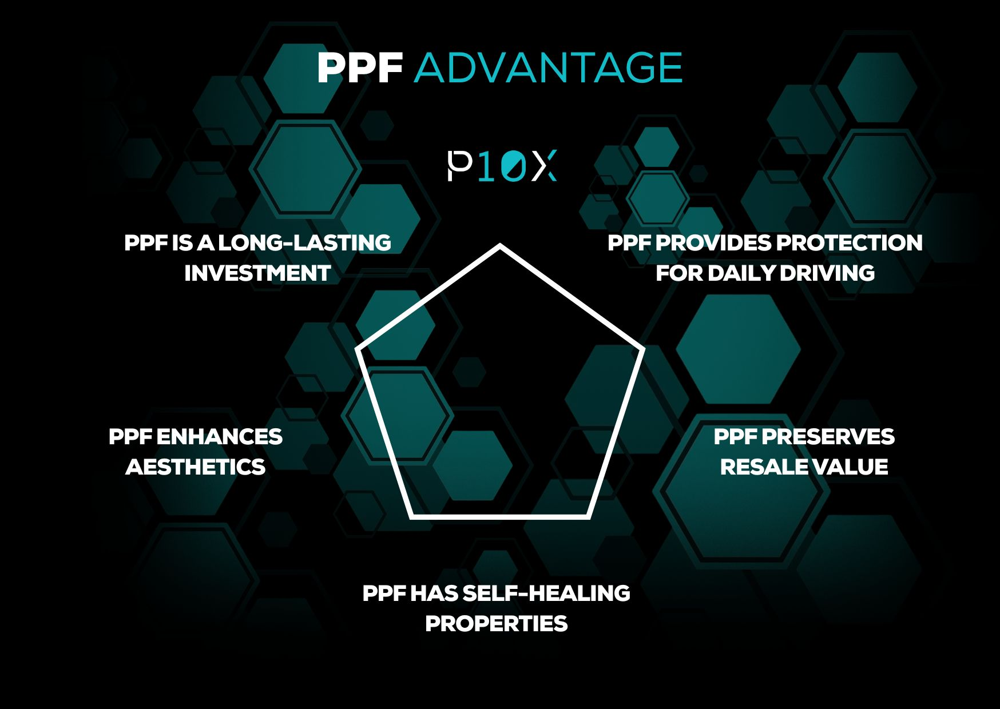
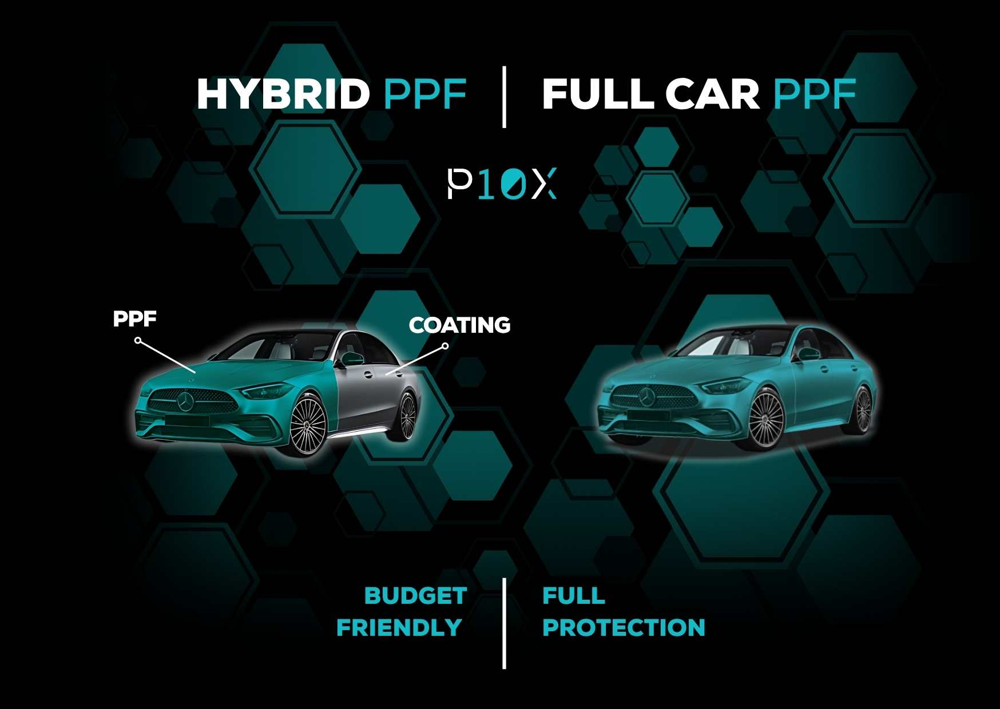
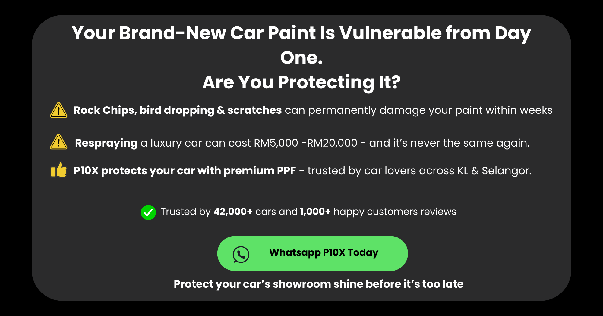

If you’ve ever cringed at a stone chip or noticed new swirl marks on your freshly washed car, you’re not alone. Many Malaysian car owners, especially those who’ve just invested in a new ride are starting to ask the big question: <strong>“Is PPF really worth it?”</strong>

Paint Protection Film (PPF) has become a buzzword in the car detailing world, but with prices running into the thousands, it’s fair to wonder if the hype matches the reality. In this guide, we’ll break down everything you need to know about <strong>PPF film</strong>—what it does, what it doesn’t, and how to decide if it’s right for your car.

Let’s get into it.

<h2 class="content-heading" id="viewer-mx2r6139133">Table Of Content</h2>

<ul class="content-list"> <li> 
<a href="#viewer-j2fw7144409"><u>Is PPF Worth It for You?</u></a>
 </li> <li> 
<a href="#viewer-tun73144933"><u>What is Paint Protection Film?</u></a>
 </li> <li> 
<a href="#viewer-c4zdu145709"><u>Things You Need to Know About PPF (Our Expert Takes)</u></a>
 </li> <li> 
<a href="#viewer-xx5uw154436"><u>Pros of Installing PPF on Cars: Why Is It Worth It For Car Owners in Malaysia</u></a>
 </li> <li> 
<a href="#viewer-hdqxq154989"><u>Factors to Consider Before Getting PPF</u></a>
 </li> <li> 
<a href="#viewer-k0lsb155533"><u>Get the Most Out of Your PPF Investment with P10X</u></a>
  </li> </ul>

<h2 class="content-heading" id="viewer-j2fw7144409"><strong>Is PPF Worth It for You?</strong></h2>

Before jumping into installation, let’s take a step back. Whether or not <strong>PPF wrap</strong> is worth it depends on a few key things about your car and how you use it:

<h3 class="content-heading" id="viewer-29b8d330"><strong>1. What is your car worth?</strong></h3>

If your car is valued above <strong>RM200,000</strong>, the investment in a <strong>car PPF</strong> makes a lot more sense. You’re protecting not just paint, but resale value, pride, and peace of mind.

<h3 class="content-heading" id="viewer-j3xpq338"><strong>2. How often do you drive on highways or congested roads?</strong></h3>

Malaysian highways can be tough on your paint. Stone chips, gravel, sand, and truck debris are common. Daily city driving also exposes your car to motorbikes, close parking spots, and random scratches.

<h3 class="content-heading" id="viewer-bks33342"><strong>3. Are you planning to keep the car long-term?</strong></h3>

If you’re planning to keep your car for more than 3 years, <strong>PPF film</strong> helps preserve the factory paint, reduces the need for polishing or repainting, and keeps the car looking newer for longer.

<h2 class="content-heading" id="viewer-tun73144933"><strong>What is Paint Protection Film?</strong></h2>

<a href="https://www.p10x.my/post/paint-protection-film-ppf-what-is-it-history-advantages"><strong><u>Paint Protection Film (PPF)</u></strong></a> is a transparent, urethane-based layer applied over your car’s painted surfaces. It acts as a physical barrier against chips, scratches, and stains—kind of like an invisible armor for your paint.

Want to dive deeper into <strong>what is PPF</strong>, <a href="https://www.p10x.my/post/ppf-vs-ceramic-coating"><strong><u>PPF vs ceramic coating</u></strong></a>, or <a href="https://www.p10x.my/post/ppf-vs-vinyl-wrap"><strong><u>PPF film vs vinyl wrap</u></strong></a><a href="https://www.p10x.my/post/ppf-vs-vinyl-wrap"><u>?</u></a> Check out our full <a href="https://www.p10x.my/post/car-ppf-malaysia-guide"><u>Car PPF in Malaysia 2025 Guide</u></a> and related articles at P10X.

<h2 class="content-heading" id="viewer-c4zdu145709"><strong>Things You Need to Know About PPF (Our Expert Takes)</strong></h2>

<h3 class="content-heading" id="viewer-pxhyy367"><strong>Why is PPF So Expensive? The Reality of PPF Cost.</strong></h3>

Here’s why:

<ul class="content-list"> <li> 
<strong>Material cost</strong>: Quality <strong>TPU PPF</strong> is imported and costly.
 </li> <li> 
<strong>Labor-intensive</strong>: It takes up to 4–5 days for proper installation.
 </li> <li> 
<strong>Skill matters</strong>: A professional finish requires experience and training.
  </li> </ul>

🔧 A full Good Quality <strong>PPF wrap</strong> can range from RM7,000 to RM20,000 in Malaysia. But compare that to the cost of repainting (RM8,000+ for premium finishes) or frequent paint correction, and it starts to make sense.

💡 <em>Budget Tip</em>: Consider our Hybrid PPF package at P10X—it covers high-risk areas with film and the rest with coating, saving up to <strong>50%</strong> compared to full-body PPF.

<h3 class="content-heading" id="viewer-tnyib396"><strong>Can PPF Really Protect Your Car?</strong></h3>

Absolutely—but within reason.

<ul class="content-list"> <li> 
It protects against <strong>stone chips</strong>, <strong>light scratches</strong>, <strong>bird droppings</strong>, and <strong>acid rain</strong>.
 </li> <li> 
If a stone hits hard, the <strong>PPF may tear</strong>, but the paint underneath remains safe.
  </li> </ul>

<h3 class="content-heading" id="viewer-sv7xa417"><strong>Does PPF Damage Car Paint?</strong></h3>

No—<strong>not if done right</strong>.

<ul class="content-list"> <li> 
<strong>On factory paint</strong>: Safe and removable.
 </li> <li> 
<strong>On resprayed panels</strong>: Risky, especially with low-quality jobs.
 </li> <li> 
At P10X, we only allow <strong>Certified Installers</strong> to work on your car, so your OEM paint stays untouched. Our installer needs to undergo at least 6 months of training and annual examination to make sure they meet our industry standard workmanship.
  </li> </ul>

<h3 class="content-heading" id="viewer-oe856437"><strong>Does PPF Turn Yellow Over Time?</strong></h3>

Some lower-grade films do. But:

<ul class="content-list"> <li> 
But <strong>high-quality TPU</strong> resists yellowing for years. More to know about <a href="https://www.p10x.my/post/ppf-tpu-or-tph"><u>TPU or TPH PPF</u></a>.
 </li> <li> 
Regular cleaning slows discoloration.
 </li> <li> 
<a href="https://www.p10x.my/post/ppf-on-used-car-on-white-car"><u>On white or light cars</u></a>, any yellowing is mostly <strong>cosmetic</strong>, not protective.
  </li> </ul>

<h3 class="content-heading" id="viewer-w0x1j455"><strong>Is PPF Hard to Maintain?</strong></h3>

Not really. In fact, it makes things easier:

<ul class="content-list"> <li> 
Hydrophobic surface = <strong>less dust</strong>, <strong>fewer water spots</strong>, <strong>easier cleaning</strong>.
 </li> <li> 
Just wash it as usual—avoid harsh chemicals or abrasive towels.Warning: <strong>Bad installs</strong> can cause bubbling, edges that trap dirt, or peeling.
  </li> </ul>

<h3 class="content-heading" id="viewer-4evy7474"><strong>Does PPF Really Self-Heal?</strong></h3>

Yes—well, kind of.

<ul class="content-list"> <li> 
<strong>Minor scratches or swirl marks</strong>? <a href="https://www.p10x.my/post/ppf-self-healing-magic"><u>The film “heals” with heat</u></a> (like sunlight or warm water).
 </li> <li> 
<strong>Deep scratches or chemical burns</strong>? No self-healing here—you may need panel replacement.
  </li> </ul>

<h3 class="content-heading" id="viewer-wuxwb487"><strong>Is PPF Only for New Cars? Should I Get PPF on a Used Car?</strong></h3>

<ul class="content-list"> <li> 
New cars? Perfect. Preserve that showroom shine.
 </li> <li> 
Used cars? Still worth it—but the paint needs correction first. PPF will lock in any imperfections beneath, so fix swirl marks, oxidation, or chips beforehand.
 </li> </ul>

<h2 class="content-heading" id="viewer-xx5uw154436"><strong>Pros of Installing PPF on Cars: Why Is It Worth It For Car Owners in Malaysia</strong></h2>

<figure class="content-image size-full"></figure>

<h3 class="content-heading" id="viewer-kfm3r500"><strong>1. PPF Provides Protection for Daily Driving</strong></h3>

PPF shields your paint from:

<ul class="content-list"> <li> 
Rock chips and road debris
 </li> <li> 
Bug splatter and bird droppings
 </li> <li> 
Tree sap and acid rain
 </li> </ul>

Perfect for Malaysia’s <strong>hot weather</strong>, <strong>sudden downpours</strong>, and tight parking spots.

<h3 class="content-heading" id="viewer-k2aff520"><strong>2. PPF Preserves Resale Value</strong></h3>

<ul class="content-list"> <li> 
Keeps the <strong>original paint intact</strong>—a big plus for secondhand buyers.
 </li> <li> 
Especially beneficial for <strong>luxury or performance cars</strong>.
 </li> </ul>

Anecdote: Some Tesla owners with PPF sold their cars 10–15% higher than market value thanks to flawless exterior condition.

<h3 class="content-heading" id="viewer-615l6535"><strong>3. PPF Has Self-Healing Properties</strong></h3>

Light scratches from fingernails, car washes, or door dings? Just leave the car under the sun, and they often disappear.

<h3 class="content-heading" id="viewer-w6207539"><strong>4. PPF Enhances Aesthetics</strong></h3>

Choose from:

<ul class="content-list"> <li> 
<strong>Glossy PPF</strong> – for that deep shine
 </li> <li> 
<strong>Matte PPF</strong> – for a stealthy finish
 </li> </ul>

Bonus: <strong>Water beads off easily</strong>, and you’ll wash your car less often.

<h3 class="content-heading" id="viewer-oec2u556"><strong>5. PPF is a Long-lasting Investment</strong></h3>

<ul class="content-list"> <li> 
Lifespan: <strong>5 to 10 years</strong> with proper care
 </li> <li> 
Saves you money on:
 <ul> <li> 
Paint correction
 </li> <li> 
Polishing
 </li> <li> 
Resprays
 </li> </ul> </li> </ul>

<h2 class="content-heading" id="viewer-hdqxq154989"><strong>Factors to Consider Before Getting PPF</strong></h2>

<h3 class="content-heading" id="viewer-1z0jl165469">Choose the Right Paint Protection Film</h3>

Not all PPFs are created equal.

<ul class="content-list"> <li> 
<strong>TPU PPF</strong> is the gold standard: flexible, durable, and self-healing.
 </li> <li> 
Look for <strong>UV inhibitors</strong> to avoid yellowing.
 </li> <li> 
Ensure the film offers <strong>optical clarity</strong>.
  </li> </ul>

<h3 class="content-heading" id="viewer-mb1sk600"><strong>Choose the Right PPF Installer</strong></h3>

The truth? A cheap install ruins even the best film.

<ul class="content-list"> <li> 
Look for <strong>certified or trained installers</strong>.
 </li> <li> 
Ask about past work, reviews, and warranty.
  </li> </ul>

<h3 class="content-heading" id="viewer-c1zcg613"><strong>Understand Your PPF Warranty &amp; Aftercare</strong></h3>

Most quality films come with a <strong>5 to 10-year warranty</strong>.

<ul class="content-list"> <li> 
Covers yellowing, cracking, and bubbling (if cared for properly).
 </li> <li> 
Follow your installer’s <strong>aftercare instructions</strong> to keep the warranty valid.
 </li> </ul>

<h2 class="content-heading" id="viewer-k0lsb155533"><strong>Get the Most Out of Your PPF Investment with P10X</strong></h2>

At <strong>P10X</strong>, we specialize in premium <strong>car paint protection</strong> services in Malaysia.

✅ We only use <strong>TPU-based PPF films</strong> from trusted brands Like 3M, Quad Film and Rhinepro. 

✅ Our team is <strong>SLDN-certified</strong>, ensuring safe installation every time.

✅ We offer two popular packages:

<ul class="content-list"> <li> 
<strong>Full Body PPF</strong> – maximum protection
 </li> <li> 
<strong>Hybrid PPF (PPF + Coating)</strong> – budget-friendly and effective
 </li> </ul>

<figure class="content-image size-full"> <figcaption class="content-element-caption">Comparison Hybrid PPF and Full Car PPF</figcaption> </figure>

<figure class="content-image size-full"></figure>

<h2 class="content-heading" id="viewer-003i8657"><strong>Conclusion</strong></h2>

So, is PPF worth it?

If you value your car’s appearance, want to keep it looking new, and drive regularly in Malaysia’s traffic and weather—<strong>yes</strong>, <strong>PPF is a smart investment</strong>.

From daily protection to long-term value, it’s a move many car owners are glad they made.

<strong>Ready to protect your paint?</strong> Contact the P10X team today and find the right PPF package for your car.

<h2 class="content-heading" id="viewer-r8xey674"><strong>FAQ </strong></h2>

<strong>How do I choose between full-body PPF and a hybrid package?</strong>

If you’re driving daily in high-risk areas (e.g., highways), full-body PPF offers complete peace of mind. Hybrid PPF is ideal if you want to save money but still protect critical areas like the front bumper, hood, and mirrors.

<strong>What are the signs of poor PPF installation?</strong>

Look out for bubbling, dirt trapped under the film, lifted edges, or poor alignment. These are signs the film wasn’t installed properly.

<strong>Can I wax or polish my car if it has PPF installed?</strong>

Yes—but choose <strong>PPF-safe</strong> products. Avoid abrasives or harsh compounds that can dull or scratch the film.

<strong>What does a typical PPF warranty cover?</strong>

Most warranties cover <strong>yellowing</strong>, <strong>cracking</strong>, <strong>peeling</strong>, and <strong>bubbling</strong>, provided you follow proper maintenance routines.

<strong>Does PPF devalue a car?</strong>

Not at all. In fact, it can <strong>increase resale value</strong> by preserving the factory finish, especially for higher-end vehicles.

<h2 class="content-heading" id="viewer-a6hab684">About The Author</h2>

<figure class="content-image size-full"></figure>

<strong>Fabian</strong>

He is passionate about revolutionizing the car protection services industry by bringing innovation and transparency to a traditionally opaque and often misunderstood field. His mission is to educate end users on the true benefits and importance of car protection, aiming to replace outdated practices with honest, customer-focused solutions.

With a fresh approach to car Tinting, Paint Protection Film (PPF), and Detailing Services, he is committed to delivering a superior customer experience that sets a new standard in the market. He welcomes discussions about the future of the automotive industry and is eager to connect with like-minded professionals who share his vision for innovation, integrity, and excellence.

