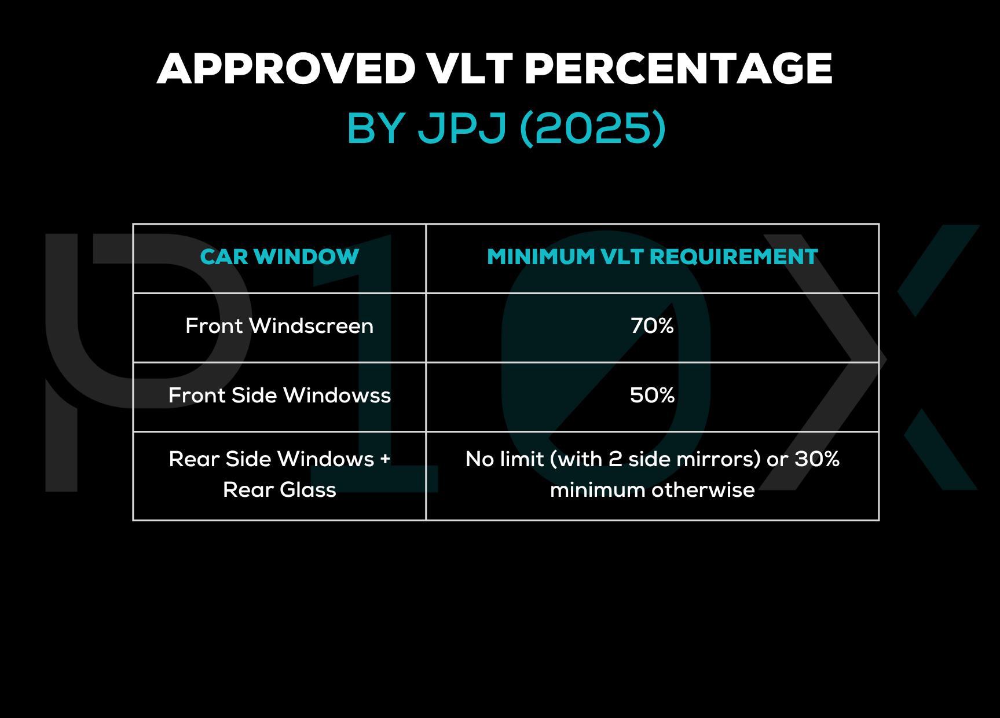
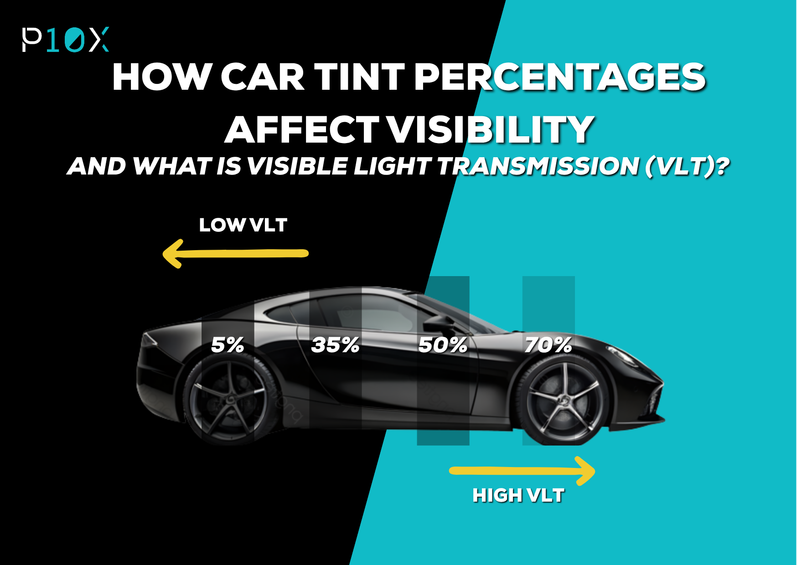
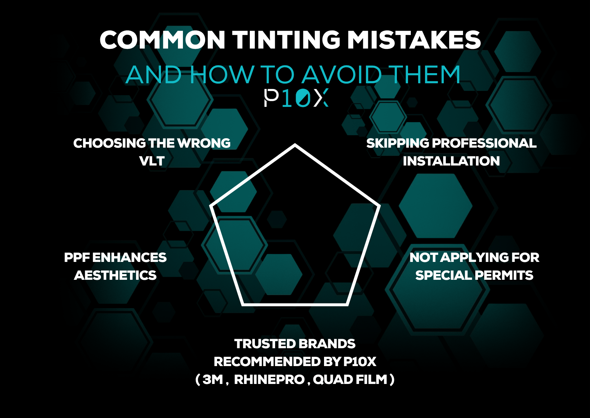
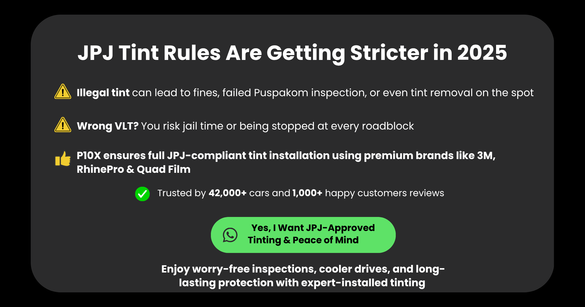

If you’re looking into <strong>car tint Malaysia</strong> solutions in 2025, one thing is clear — you can’t ignore the <strong>JPJ tinted rules</strong>. Whether <a href="https://www.p10x.my/post/understanding-car-tint-101"><u>you’re understanding car tint </u></a>basics, <a href="https://www.p10x.my/post/how-to-choose-a-car-tint"><u>choosing the right tint</u></a> for your needs, or exploring the <a href="https://www.p10x.my/post/benefits-of-window-tint"><u>benefits of window tint</u></a>, knowing the latest <strong>tint percentage regulations</strong> is essential.

It’s not just about avoiding fines or passing <a href="https://www.p10x.my/post/car-window-tint-during-puspakom-inspection"><u>PUSPAKOM inspection</u></a> — it’s about safety, comfort, and making smart choices. You might also be wondering things like: <em>“</em><a href="https://www.p10x.my/post/will-tinting-affect-my-smart-tag-or-my-rfid"><em><u>Will tinting affect my SmartTAG or RFID?</u></em></a><em>”</em>. With so many<a href="https://www.p10x.my/post/5-types-of-car-window-tint-you-should-know"><u> types of car tint</u></a> on the market today, from ceramic to photochromic, this guide will walk you through what matters most for 2025 and how to stay JPJ-compliant.

<h2 class="content-heading" id="viewer-ekxps101256">Table of Content :</h2>

<ul class="content-list"> <li> 
<a href="#viewer-x1ym699798"><u>What Are JPJ Rules on Tinted Windows in Malaysia?</u></a>
 </li> <li> 
<a href="#viewer-bg079147710"><u>How Car Tint Percentages Affect Visibility and What is Visible Light Transmission (VLT)?</u></a>
 </li> <li> 
<a href="#viewer-gf10s148119"><u>How to Ensure Your Car Tint Passes Puspakom Inspection and JPJ Compliance?</u></a>
 </li> <li> 
<a href="#viewer-oxacl148342"><u>Common Tinting Mistakes and How to Avoid Them</u></a>
 </li> <li> 
<a href="#viewer-4yk3a149529"><u>How to Ensure Your Car Tint Complies with JPJ Regulations?</u></a>
 </li> </ul>

<h2 class="content-heading" id="viewer-x1ym699798">What Are JPJ Rules on Tinted Windows in Malaysia?</h2>

The <strong>Jabatan Pengangkutan Jalan (JPJ)</strong> regulates car tint to ensure all vehicles on the road are safe — especially in low-light or rainy conditions.

<h3 class="content-heading" id="viewer-4dfbt99804">Approved VLT Percentages by JPJ (2025)</h3>

<figure class="content-image size-full"></figure>

<h3 class="content-heading" id="viewer-cc3dr99841">Exceptions for Special Vehicles</h3>

Some vehicles are allowed a darker tint under special circumstances:

<ul class="content-list"> <li> 
<strong>Medical reasons</strong> (e.g. light sensitivity, skin conditions)
 </li> <li> 
<strong>Government, VIP, or executive vehicles</strong> with approved permits
 </li> </ul>

<h3 class="content-heading" id="viewer-zqg2499854">Penalties for Non-Compliance</h3>

If your car tint does not follow JPJ specs:

<ul class="content-list"> <li> 
Fine of up to <strong>RM2,000</strong>
 </li> <li> 
Up to <strong>6 months jail</strong>
 </li> <li> 
Immediate <strong>removal of tint on the spot</strong>
 </li> </ul>

At <strong>P10X</strong>, we check your VLT before installing, so you don’t risk these penalties later.

<h2 class="content-heading" id="viewer-bg079147710">How Car Tint Percentages Affect Visibility and What is Visible Light Transmission (VLT)?</h2>

<h3 class="content-heading" id="viewer-tnb8199877">What is VLT?</h3>

<strong>VLT (Visible Light Transmission)</strong> measures how much visible light can pass through a window. It’s expressed in percentages:

<ul class="content-list"> <li> 
<strong>Higher VLT = lighter tint = more visibility</strong>
 </li> <li> 
<strong>Lower VLT = darker tint = less visibility</strong>
 </li> </ul>

<h3 class="content-heading" id="viewer-41jr599889">Common VLT Percentages Explained</h3>

<ul class="content-list"> <li> 
<strong>70% VLT</strong> — Required for windscreen. Very light but still blocks UV.
 </li> <li> 
<strong>50% VLT</strong> — Legal for front side windows. Offers moderate privacy and glare reduction.
 </li> <li> 
<strong>35% VLT</strong> — Popular for rear windows. Darker, more private.
 </li> <li> 
<strong>5% VLT</strong> — “Limo tint”. Too dark for legal use without a special permit.
 </li> </ul>

<h3 class="content-heading" id="viewer-jmjox99908">Why This Matters</h3>

<ul class="content-list"> <li> 
Low VLT can fail <strong>Puspakom inspections</strong>
 </li> <li> 
Dark tints can be unsafe at night or during rain
 </li> <li> 
VLT does <strong>not</strong> equal heat rejection — even a high-VLT <strong>ceramic tint</strong> can reject heat effectively
 </li> </ul>

<figure class="content-image size-full"></figure>

<h2 class="content-heading" id="viewer-gf10s148119">How to Ensure Your Car Tint Passes Puspakom Inspection and JPJ Compliance?</h2>

When going for <strong>Puspakom</strong> inspection (e.g. ownership transfer, e-hailing, road tax renewal), VLT is checked using a tint meter.

<h3 class="content-heading" id="viewer-fjxze99935">Puspakom Checks for:</h3>

<ul class="content-list"> <li> 
Whether the tint film meets JPJ’s minimum VLT
 </li> <li> 
If tint is peeling, bubbling, or too dark
 </li> <li> 
Whether the car has proper side mirrors for darker rear tints
 </li> </ul>

<h3 class="content-heading" id="viewer-4wfcu99947">What Happens If You Fail?</h3>

<ul class="content-list"> <li> 
You’ll be asked to <strong>remove the tint</strong>
 </li> <li> 
You must <strong>re-inspect</strong> (with added cost + hassle)
 </li> <li> 
It can delay your road tax renewal or vehicle sale
 </li> </ul>

<h3 class="content-heading" id="viewer-h4gj499962">How to Prepare</h3>

<ul class="content-list"> <li> 
Use a <strong>tint specialist</strong> (like P10X) that measures your VLT before tinting
 </li> <li> 
Don’t rely on guesswork — factory tints or DIY tints may not be compliant
 </li> <li> 
Choose JPJ-compliant brands like <strong>3M</strong>, <strong>Raytech</strong>, <strong>RhinePro</strong>, <strong>LLumar</strong>, and <strong>V-Kool</strong>
 </li> </ul>

<h2 class="content-heading" id="viewer-oxacl148342">Common Tinting Mistakes and How to Avoid Them</h2>

Before you get your car windows tinted, it’s worth learning from the common mistakes many Malaysian car owners make. From choosing the wrong <strong>VLT percentage</strong> to using cheap, non-compliant brands, these small errors can lead to inspection failures, fines, or wasted money. The good news? They’re all easily avoidable when you know what to look out for — and that’s exactly what we’ll cover below.

<h3 class="content-heading" id="viewer-a184f99987">Choosing the Wrong VLT</h3>

Many owners mistakenly install <strong>20% or 5% tint</strong> on front windows — which is <strong>illegal</strong>. Stick to 50% for side windows and 70% for windscreens.

<h3 class="content-heading" id="viewer-d6u0899995">Using Non-Compliant Tint Brands</h3>

Cheap tints often:

<ul class="content-list"> <li> 
Fade, peel, or bubble
 </li> <li> 
Have incorrect or unverified VLT values
 </li> <li> 
Don’t block UV or IR rays effectively
 </li> </ul>

<h3 class="content-heading" id="viewer-vi7nz100009">Trusted Brands Recommended by P10X:</h3>

<ul class="content-list"> <li> 
<strong>3M Tint Malaysia</strong> (Crystalline, Ceramic IR)
 </li> <li> 
Quad Film
 </li> <li> 
<strong>RhinePro Tint</strong> 
  </li> </ul>

<h3 class="content-heading" id="viewer-tz059100030">Skipping Professional Installation</h3>

Even the best tint film can look bad and fail inspection if it’s poorly installed. Trust certified installers for clean lines, bubble-free results, and guaranteed compliance.

<h3 class="content-heading" id="viewer-nyx8q100034">Not Applying for Special Permits</h3>

Some drivers qualify for darker tint due to medical conditions — but you need a <strong>JPJ permit</strong>. Don’t assume you’re exempt without approval.

<figure class="content-image size-full"></figure>

<h2 class="content-heading" id="viewer-4yk3a149529">How to Ensure Your Car Tint Complies with JPJ Regulations?</h2>

Before you commit to a tint job, it’s useful to see exactly how the rules are interpreted and applied in real life. Below is a video that walks you through JPJ’s tint regulations and practical tips for staying road-legal in 2025: 

<h3 class="content-heading" id="viewer-eba8y220773">Work with a Tint Specialist Who Knows the Rules</h3>

At <strong>P10X</strong>, our team:

<ul class="content-list"> <li> 
Measures your current VLT with accurate tools
 </li> <li> 
Recommends films based on legal spec + your lifestyle needs
 </li> <li> 
Uses only compliant, certified films for peace of mind
  </li> </ul>

<h3 class="content-heading" id="viewer-fl8q3220790">Choosing the Right Tint Film</h3>

<ul class="content-list"> <li> 
Go for <strong>ceramic tint</strong> or <strong>nano-ceramic</strong> for high IR rejection without needing a dark VLT
 </li> <li> 
Ensure the brand lists <strong>VLT</strong>, <strong>TSER</strong>, and <strong>IRR</strong>
 </li> <li> 
Match the VLT to your vehicle’s inspection requirements
 </li> </ul>

JPJ’s tint rules are not just about legal compliance — they’re about protecting you, your passengers, and your investment. Whether you’re going for <strong>privacy</strong>, <strong>heat rejection</strong>, or <strong>aesthetic upgrades</strong>, choosing a tint that meets <strong>VLT Malaysia JPJ</strong> standards is key.

And with <strong>P10X</strong>, you get the full package: legal, long-lasting, and high-performance tints that help you drive with peace of mind.

<figure class="content-image size-full"></figure>

<h2 class="content-heading" id="viewer-cx3dx100142">FAQ</h2>

 <strong>Can I install the darkest possible tint on my car?</strong>

Only on the rear side windows and rear windscreen — and only if your car has two functioning side mirrors. Front glass must comply with JPJ VLT rules.

<strong>Does window tint affect the resale value of my car in Malaysia?</strong>

Yes. JPJ-compliant, branded tint improves resale value. Illegal or poor-quality tint may deter buyers.

<strong>How can I check if my current car tint complies with JPJ regulations?</strong>

Use a VLT meter or visit a tint shop like P10X for a free compliance check.

<strong>What is the difference between IRR tint and ceramic tint?</strong>

IRR measures how much heat the tint blocks. Ceramic tint is the material — it blocks heat without affecting visibility or signal.

<strong>Does car tinting affect GPS, RFID, or SmartTAG?</strong>

Yes — metal-based films can interfere. We recommend ceramic or nano-ceramic films for <strong>signal-safe</strong> performance.

<h2 class="content-heading" id="viewer-27c175191">About The Author</h2>

<figure class="content-image size-full"></figure>

<strong>Fabian</strong>

He is passionate about revolutionizing the car protection services industry by bringing innovation and transparency to a traditionally opaque and often misunderstood field. His mission is to educate end users on the true benefits and importance of car protection, aiming to replace outdated practices with honest, customer-focused solutions.

With a fresh approach to car tinting, paint protection film (PPF), and detailing services, he is committed to delivering a superior customer experience that sets a new standard in the market. He welcomes discussions about the future of the automotive industry and is eager to connect with like-minded professionals who share his vision for innovation, integrity, and excellence.

