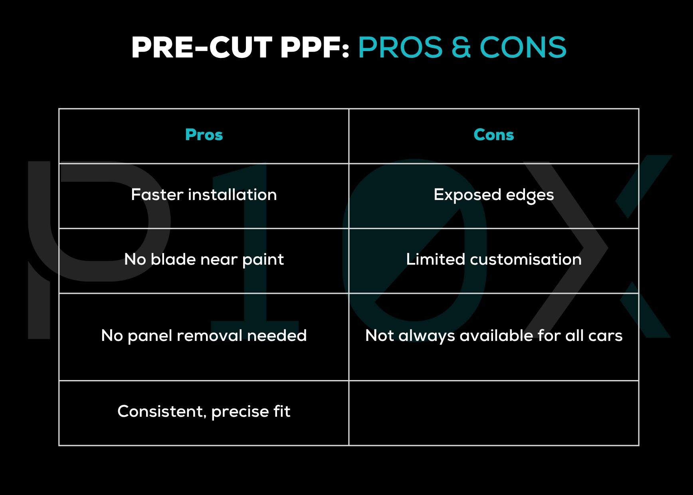
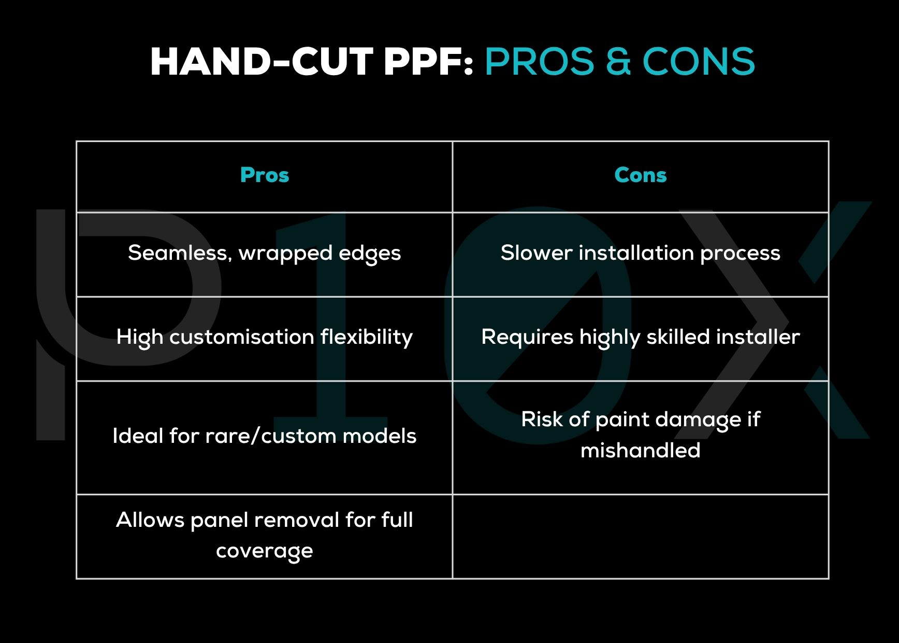
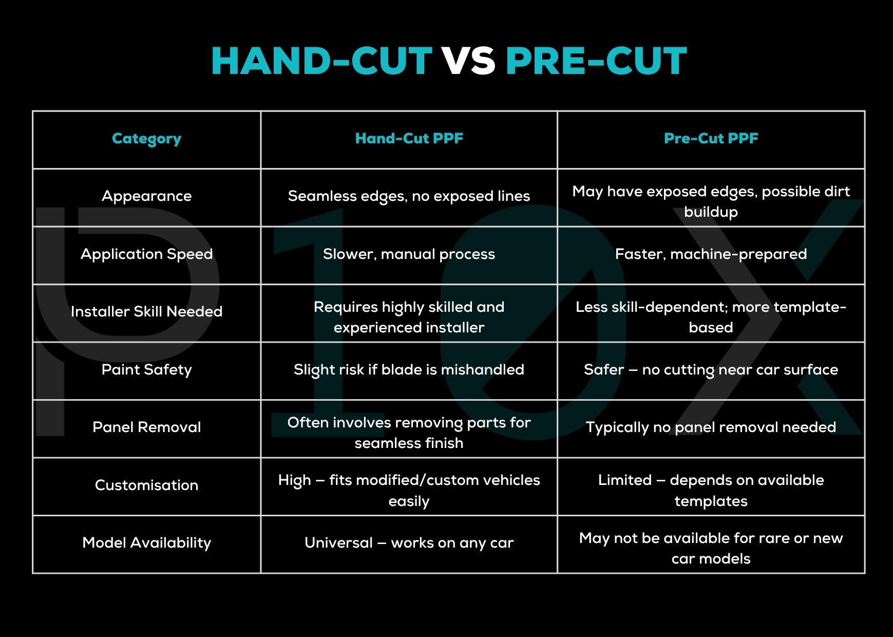
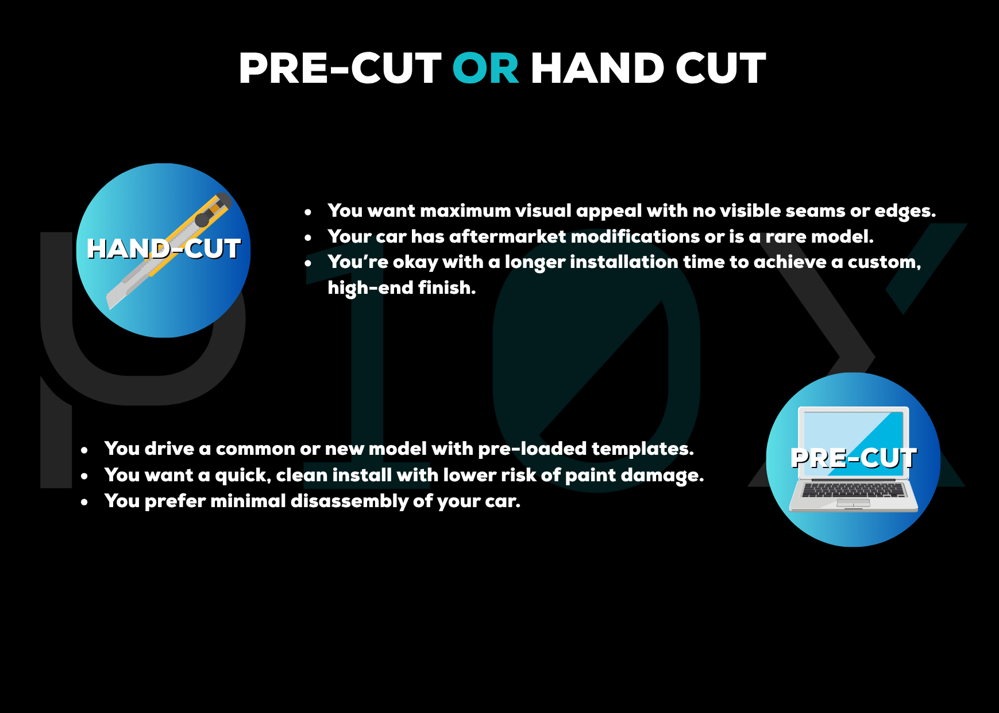
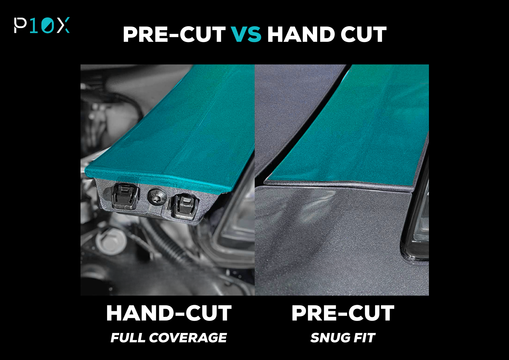
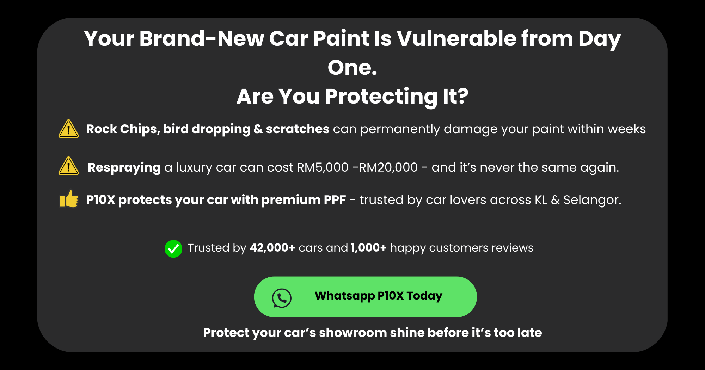

So, you’ve decided to protect your car with <strong>Paint Protection Film (PPF)?</strong> Great choice! Whether you’re a car enthusiast or just someone who wants to keep your car looking new, PPF — also known as a car protection film or PPF wrap — acts like an invisible shield against chips, scratches, and daily wear. Before installation, it’s also worth understanding the differences between film application methods. Check out our Guide to Pre-Cut PPF vs Hand-Cut PPF to see which approach best suits your car and budget.

<h2 class="content-heading" id="viewer-cpkbb62837">Table of Content</h2>

<ul class="content-list"> <li> 
<a href="#viewer-tlymj213316"><u>What is Pre-Cut PPF?</u></a>
 </li> <li> 
<a href="#viewer-vmzft213736"><u>What is Hand-Cut PPF?</u></a>
 </li> <li> 
<a href="#viewer-uki09214157"><u>Pre-Cut PPF vs Hand-Cut PPF: What are the Differences?</u></a>
 </li> <li> 
<a href="#viewer-kw5r6214641"><u>Looking for a PPF Installer Skilled in Both Pre-Cut and Hand-Cut Methods?</u></a>
  </li> </ul>

When it comes to <em>how to install PPF film</em>, there are two main methods: <strong>Pre-Cut PPF</strong> and <strong>Hand-Cut PPF</strong>. Each method has its pros and cons. In this guide, we’ll walk you through both so you can decide which fits your car and your needs best. If you’re still exploring the basics of PPF, check out our complete <a href="https://www.p10x.my/post/car-ppf-malaysia-guide"><u>Car PPF Malaysia Guide </u></a>to learn about its pros, cons, types, and costs.

<h2 class="content-heading" id="viewer-tlymj213316">What is Pre-Cut PPF?</h2>

Pre-cut PPF refers to <em>paint protection film</em> that’s digitally designed and machine-cut to match specific makes and models. These patterns are created using software and plotter machines, ensuring each piece is cut to precise dimensions before being applied to your car.

<h3 class="content-heading" id="viewer-did7d63128">Strengths of Pre-Cut PPF</h3>

Here’s why many car owners (especially those who value precision and speed) choose pre-cut PPF:

<ul class="content-list"> <li> 
<strong>Faster installation</strong> – No need to measure or cut on the spot.
 </li> <li> 
<strong>Lower risk of paint damage</strong> – No blades are used near your car’s surface.
 </li> <li> 
<strong>No panel removal needed</strong> – Great if you want to keep your car intact.
 </li> <li> 
<strong>Consistency</strong> – Cuts are machine-precise, ensuring a uniform fit.
  </li> </ul>

<h3 class="content-heading" id="viewer-2ahta63149">Limitations of Pre-Cut PPF</h3>

But it’s not perfect for every situation. Here are a few things to keep in mind:

<ul class="content-list"> <li> 
<strong>Exposed edges</strong> – May leave tiny visible edges that collect dirt.
 </li> <li> 
<strong>Limited customisation</strong> – Not ideal for modified or rare cars.
 </li> <li> 
<strong>Not always available</strong> – Some models may not have templates yet.
 </li> </ul>

<figure class="content-image size-full"></figure>

<h2 class="content-heading" id="viewer-vmzft213736">What is Hand-Cut PPF?</h2>

Hand-cut PPF is exactly what it sounds like — skilled installers cut the PPF manually on your car, using their experience and technique to create a custom fit.

<h3 class="content-heading" id="viewer-g8vqt63174">Strengths of Hand-Cut PPF</h3>

For those who want the ultimate aesthetic, hand-cut PPF has some clear benefits:

<ul class="content-list"> <li> 
<strong>Seamless finish</strong> – Installers can tuck edges for a nearly invisible look.
 </li> <li> 
<strong>Custom fit</strong> – Ideal for custom vehicles or body kits.
 </li> <li> 
<strong>Flexible install</strong> – With panel removal, full-wrap coverage is possible.
  </li> </ul>

<h3 class="content-heading" id="viewer-ugb5e63191">Limitations of Hand-Cut PPF</h3>

Still, hand-cutting isn’t for everyone:

<ul class="content-list"> <li> 
<strong>Slower process</strong> – Precision takes time.
 </li> <li> 
<strong>Highly skill-dependent</strong> – Results vary by installer.
 </li> <li> 
<strong>Higher risk</strong> – If done improperly, it can nick your paint.
 </li> </ul>

Choosing the right type of film matters too — see the full breakdown in <a href="/insights/ppf-film-types/"><u>Types of PPF Film</u></a>.

<figure class="content-image size-full"></figure>

<h2 class="content-heading" id="viewer-uki09214157">Pre-Cut PPF vs Hand-Cut PPF: What are the Differences?</h2>

Let’s break it down further so you can see the direct comparisons.

<h3 class="content-heading" id="viewer-714t863216">Appearance</h3>

<ul class="content-list"> <li> 
<strong>Hand-Cut PPF</strong>: Edges are often wrapped and hidden. Sleeker look.
 </li> <li> 
<strong>Pre-Cut PPF</strong>: May leave small exposed edges, which can collect dust or dirt over time.
  </li> </ul>

<h3 class="content-heading" id="viewer-dgc8x63227">Application Speed</h3>

<ul class="content-list"> <li> 
<strong>Hand-Cut PPF</strong>: Takes longer due to manual cutting and wrapping.
 </li> <li> 
<strong>Pre-Cut PPF</strong>: Faster, since pieces are ready to apply straight from the plotter.
  </li> </ul>

<h3 class="content-heading" id="viewer-yr9cl63238">PPF Installer Skill Requirements</h3>

<ul class="content-list"> <li> 
<strong>Hand-Cut PPF</strong>: Needs a highly trained and experienced installer.
 </li> <li> 
<strong>Pre-Cut PPF</strong>: More forgiving; less reliant on manual skill.
  </li> </ul>

💡 At <strong>P10X</strong>, all our installers are <strong>well-trained and certified</strong> in both techniques. For hand-cut PPF, we even use <strong>digital cutters</strong> to pre-mark the film and apply it with <strong>precise techniques</strong>, minimising any risk to your car’s paint.

<h3 class="content-heading" id="viewer-6lnhl63264">Body Panel Removal during PPF Installation</h3>

<ul class="content-list"> <li> 
<strong>Hand-Cut PPF</strong>: Often involves removing parts like side mirrors or handles for better wrapping.
 </li> <li> 
<strong>Pre-Cut PPF</strong>: Typically doesn’t require removing parts.
 </li> </ul>

🛠️ <em>At P10X, for the best coverage — regardless of method — we may recommend removing certain parts like door handles for a more seamless result.</em>

<h3 class="content-heading" id="viewer-iwspc63278">PPF Film Customisation</h3>

<ul class="content-list"> <li> 
<strong>Hand-Cut PPF</strong>: Perfect for one-off designs or rare body shapes.
 </li> <li> 
<strong>Pre-Cut PPF</strong>: Limited flexibility — what’s cut is what you get.
  </li> </ul>

<h3 class="content-heading" id="viewer-pmrkt63289">PPF Film Availability</h3>

<ul class="content-list"> <li> 
<strong>Hand-Cut PPF</strong>: Always an option — no template needed.
 </li> <li> 
<strong>Pre-Cut PPF</strong>: May not be available for newly released or exotic models.
  </li> </ul>

<figure class="content-image size-full"></figure>

<h2 class="content-heading" id="viewer-k8u0963304">Pre-Cut PPF vs Hand-Cut PPF: Which is the Right One to Choose?</h2>

The truth? <strong>There’s no one-size-fits-all answer.</strong> Each method has its place depending on your priorities, your car, and the installer’s experience.

At <strong>P10X</strong>, we tailor our installation method to <strong>your needs and goals</strong> — not just what’s easiest or fastest.

<h3 class="content-heading" id="viewer-71d8v63316">When is Hand-Cut PPF Better?</h3>

Choose <strong>hand-cut PPF</strong> when:

<ul class="content-list"> <li> 
You want <strong>maximum visual appeal</strong> with no visible seams or edges.
 </li> <li> 
Your car has <strong>aftermarket modifications</strong> or is a rare model.
 </li> <li> 
You’re okay with a longer installation time to achieve a <strong>custom, high-end finish</strong>.
  </li> </ul>

<h3 class="content-heading" id="viewer-3b2er63338">When is Pre-Cut PPF Better?</h3>

Go for <strong>pre-cut PPF</strong> if:

<ul class="content-list"> <li> 
You drive a <strong>common or new model</strong> with pre-loaded templates.
 </li> <li> 
You want a <strong>quick, clean install</strong> with a <strong>lower risk</strong> of paint damage.
 </li> <li> 
You prefer <strong>minimal disassembly</strong> of your car.
 </li> </ul>

<figure class="content-image size-full"></figure>

Wondering which brand to choose for your car? Here’s our list of the <a href="/insights/best-ppf-film-malaysia/"><u>Best PPF Films in Malaysia.</u></a>

<h2 class="content-heading" id="viewer-kw5r6214641">Looking for a PPF Installer Skilled in Both Pre-Cut and Hand-Cut Methods?</h2>

At <strong>P10X</strong>, our installers are <strong>certified</strong>, highly skilled, and trained in <strong>both hand-cut and pre-cut</strong> installations. Whether you’re looking for factory-clean consistency or an ultra-premium, tucked-edge finish — we’ve got the expertise to do it right.

We use:

<ul class="content-list"> <li> 
<strong>Digital cutting machines</strong> for precision
 </li> <li> 
<strong>TPU PPF films</strong> for superior clarity and self-healing
 </li> <li> 
<strong>Tailored installation methods</strong> based on your car and preferences
 </li> </ul>

<figure class="content-image size-full"></figure>

<h2 class="content-heading" id="viewer-lbtom63395">Conclusion</h2>

Choosing between <strong>pre-cut PPF</strong> and <strong>hand-cut PPF</strong> comes down to your priorities. Want a fast, safe install with factory-spec precision? Pre-cut might be for you. Want a seamless, high-end finish with zero visible lines? Then hand-cut is worth the extra effort.

💬 Still unsure? Our experts at P10X are happy to guide you. Whether you’re wondering <a href="/insights/ppf-cost-malaysia/"><em><u>how much to PPF a car</u></em></a>, <a href="https://www.p10x.my/post/ppf-vs-ceramic-coating"><u>comparing </u></a><a href="https://www.p10x.my/post/ppf-vs-ceramic-coating"><em><u>coating vs PPF</u></em></a>, or just want to know <a href="/insights/is-ppf-worth-it/"><em><u>is PPF really worth it</u></em></a><em><u>,</u></em> we’re here to help.

<figure class="content-image size-full"></figure>

<h2 class="content-heading" id="viewer-481kk63415">FAQ </h2>

<strong>How to cut a PPF film?</strong>

For hand-cut PPF, trained installers use precision blades and proven techniques to avoid scratching the paint. At P10X, every installer undergoes at least 6 months of training and must pass a strict internal assessment before working on customer vehicles.

<strong>How to fix cuts or scratches on PPF film?</strong>

Minor scratches can self-heal on TPU-based PPF. For deeper damage, the affected panel can be replaced.

<strong>How to install pre-cut PPF at home?</strong>

While possible, DIY installs are tricky. Pre-cut kits require surface prep, correct alignment, and air-bubble management — a professional install is recommended.

<strong>Will pre-cut PPF fit my specific vehicle model accurately?</strong>

If a template exists for your model, yes. Otherwise, hand-cutting may be necessary.

<strong>What happens if a pre-cut PPF piece doesn’t align perfectly?</strong>

Experienced installers can make slight adjustments or switch to hand-cutting if needed. At P10X, we ensure fitment accuracy before applying.

<strong>About The Author</strong>

<figure class="content-image size-full"></figure>

<strong>Fabian</strong>

He is passionate about revolutionizing the car protection services industry by bringing innovation and transparency to a traditionally opaque and often misunderstood field. His mission is to educate end users on the true benefits and importance of car protection, aiming to replace outdated practices with honest, customer-focused solutions.

With a fresh approach to car tinting, paint protection film (PPF), and detailing services, he is committed to delivering a superior customer experience that sets a new standard in the market. He welcomes discussions about the future of the automotive industry and is eager to connect with like-minded professionals who share his vision for innovation, integrity, and excellence.

